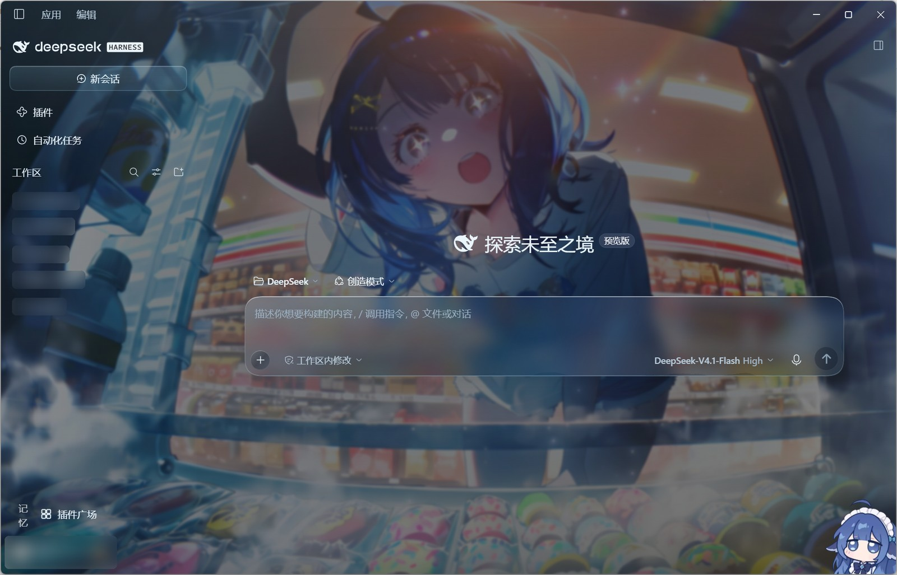

<div align="center">

# Glass Skin · 玻璃肌肤

**DeepSeek Harness Web UI 的玻璃材质主题**

冷色空间 · 暖色点睛 · 细腻材质 · 舒展排版

[](https://github.com/yesang0924-beep/dsh-glass-skin/actions/workflows/verify.yml)
[](LICENSE)
[](#自检)

[安装](#安装) · [使用](#使用) · [设计规则](#设计规则) · [已知边界](#已知边界) · [English](#english)

</div>



## 这是什么

Glass Skin 把 DSH 的 Web 界面当成一间玻璃工作室：壁纸是场景，冰蓝玻璃是工作台，暖琥珀只做高光。它不是换一套配色，而是一套**冻结的设计系统**——材质阶梯、阅读标尺、状态与场景规则都写死在样式表里，**唯一可变的输入是壁纸**。

项目从一张深夜便利店冰柜的壁纸长出来（旧名 `dsh-skin-icebox` / 冰柜暖光，5.x 的逐版设计史在 [docs/DEVLOG.md](docs/DEVLOG.md)）。6.0 起以 `dsh-glass-skin` 发布，默认壁纸仍是那张冰柜。

## 特点

| | |
|---|---|
| **三层材质阶梯** | environment → work → action。一个表面只有一层透明度，绝不自己叠自己 |
| **按面积分配的模糊** | 同一套 `saturate`，半径分档：气泡 14px、浮动面板 16px、输入框与遮罩 10px、代码块与浮层 6px |
| **阅读标尺** | 正文比「外观」字号大 2px、行高 1.8；标题、表格、引用按同一比例派生 |
| **壁纸是唯一变量** | 换图只重写 `--dsh-glass-wallpaper` 一个自定义属性；模式、场景、令牌与布局都不参与 |
| **模式与场景** | 氛围 / 专注；清透 / 标准 / 沉静。只改变壁纸的存在感，不改材质 |
| **不在运行时重建材质** | 样式表原地改写：没有 SVG 位移滤镜、没有定时轮询、没有节点重挂载 |
| **设置页自检** | 6 个必需钩子 + 6 个条件区域，命中情况一眼可见；可复制完整 JSON 报告 |
| **壁纸导入** | 拖放或选择文件；Host 按 magic bytes 只收 JPEG / PNG / WebP，上限 32MB |

> 首页预览为真机截图，账号名与工作区名已模糊处理，不含真实会话、本地路径或对话内容。

## 安装

要求：DSH Desktop / Web `0.2.x`、Node.js ≥ 22.19。

**方式一：源码目录（推荐，link 安装）**

```powershell
git clone https://github.com/yesang0924-beep/dsh-glass-skin.git
```

把**仓库目录**交给 `plugin_manager`：

```text
plugin_manager(action="install_bundle", target="D:/path/to/dsh-glass-skin")
```

`install_bundle` 对本地目录是 link 语义：之后改 `client.js`，`Ctrl+R` 即生效；改 `index.js` 需要重启 DSH。

**方式二：发布包**

到 [Releases](https://github.com/yesang0924-beep/dsh-glass-skin/releases) 下载 `dsh-glass-skin-6.0.2.tgz`，解包成目录后安装：

```powershell
tar -xzf dsh-glass-skin-6.0.2.tgz -C .\glass-skin
```

```text
plugin_manager(action="install_bundle", target="<解包目录>/package")
```

**不要把 `.tgz` 直接交给 `install_bundle`**：那会留下「`file:` 说明符 + `link:` 锁定」的混合状态。先解包。

装好后重启一次 DSH：Host 侧的路由、壁纸目录与状态文件只在应用启动时加载。

### 从旧名升级（dsh-skin-icebox）

```text
plugin_manager(action="remove_bundle", target="dsh-skin-icebox")
plugin_manager(action="install_bundle", target="<本仓库目录>")
```

重启后首次启动会自动**复制**一次旧数据——偏好文件 `~/.dsh/dsh-skin-icebox.json` 与 `~/.dsh/dsh-skin-icebox/wallpapers/` 里的图片——并在新目录写下 `.migrated-from-icebox` 标记。旧目录原样保留，可以手动删除。

## 使用

设置 →「玻璃肌肤」：

| 控件 | 说明 |
|---|---|
| 壁纸 | 内置图 / 用户图片 / 拖放导入 / 刷新；选中后只改一个 CSS 变量 |
| 模式 | 氛围：壁纸完整呈现；专注：壁纸后退、面板收拢 |
| 场景浓度 | 清透 / 标准 / 沉静，改变壁纸的存在感 |
| 设计说明与诊断 | 宿主钩子命中表、饱和/亮度取样、复制 JSON 报告 |

数据位置：

| 路径 | 内容 |
|---|---|
| `~/.dsh/dsh-glass-skin.json` | 模式 / 场景 / 壁纸选择；原子写入，损坏时移到 `.corrupt-<时间戳>` |
| `~/.dsh/dsh-glass-skin/wallpapers/` | 用户壁纸（jpg / jpeg / png / webp，文件名可用中文） |
| 包内 `assets/wallpapers/` | 随主题发布的默认集；同名文件优先用用户目录 |

## 自检

```powershell
cd dsh-glass-skin
node tools/verify.mjs
```

- 两半语法、`package.json` 与 `client.js` 版本一致
- 结构回归 **42/42**
- 旧名数据迁移 **1/1**
- 全过时输出 `ALL PACKAGE CHECKS PASSED`

结构回归证明规则确实落到了代码里，不等于观感验收：整体好不好看仍要在真窗口里看。

类型检查是开发/CI 用的另一道门（运行时零依赖，`tsc` 不进发布包）：

```powershell
npm install
npm run typecheck
```

来源文件用 `// @ts-check` + JSDoc 标注 Cordis 上下文与宿主接口，`tsconfig.json` 只做 `--noEmit` 检查。

## 项目结构

```text
client.js                         浏览器半：令牌、样式表、设置面板
index.js                          宿主半：壁纸 / 状态 / 上传路由
cordis.patch.yml                  bundle 声明
assets/                           内置壁纸
locale/                           中英文标题与描述
tools/verify.mjs                  包内自检
tools/continuous-glass.test.mjs   结构回归（42）
tools/migration.test.mjs          旧名数据迁移（1）
DESIGN.md                         可执行的视觉规则
CHANGELOG.md                      逐版变更
docs/DEVLOG.md                    6.0 之前的逐版说明
```

## 已知边界

- 标题栏「应用 / 编辑」下拉、输入框右键菜单由 Electron 主进程弹出系统菜单，不在 DOM 内，CSS 无法着色。
- DSH 升级可能改变宿主类名。设置页诊断会标出失配的钩子：`✓` 命中、`!` 失配、`?` 设置页不可见未验证、`–` 当前页没有。
- Host 侧改动需要重启；客户端改动 `Ctrl+R` 即可。
- 主题只改视觉，不影响发送、模型选择、权限和工具行为。
- Windows 标题栏三键的底色受 Electron `setTitleBarOverlay()` 限制（alpha 会被丢弃），主题交给它全透明。

## English

**Glass Skin** is a glass-material theme for the DeepSeek Harness Web UI. The material ladder, reading scale, states and scene rules are frozen in the stylesheet; the wallpaper is the only variable, injected through the single custom property `--dsh-glass-wallpaper`. Install it as a DSH bundle from the repository directory (or an unpacked release tarball) and restart DSH.

## 设计规则

- [DESIGN.md](DESIGN.md)：每条规则对应的实现位置、判据与反例
- [CHANGELOG.md](CHANGELOG.md)：用户能感知的变化与稳定性改动
- [docs/BASELINE-5.0.md](docs/BASELINE-5.0.md)：5.0 冻结基线
- [docs/DEVLOG.md](docs/DEVLOG.md)：6.0 之前的逐版说明

## License

MIT © Leaf King and Glass Skin contributors
